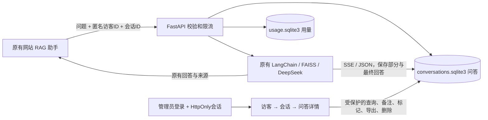

# 对话记录与私有管理后台

2026-11-04：在原有问答链路上完善访客工作台。本版经本地验收后，按用户明确指示发布到云服务器并同步 GitHub；实际验收状态见 PROJECT-STATUS.md。旧版本未保存的问答不能补录，本地与线上数据库也不会自动同步。

## 方案与边界

保留原生前端、FastAPI、LangChain 和 FAISS，沿用 SQLite 事务与索引，适合当前低并发的个人作品集，无需额外部署数据库或前端构建系统。
网站和助手保持原样式；前台不显示记录状态、暂停开关或记录故障。后台独立提供匿名访客分组、会话和完整问答。



记录、配额账本与 FAISS 相互独立。删除对话不会重置调用额度；访客聊天不会自动进入知识库。
本地数据库：`backend/storage/conversations.sqlite3`。云端沿用 `STORAGE_DIR`：`/var/lib/wx-rag/conversations.sqlite3`。
数据、真实配置、后台登录资料不进入 GitHub 或公开 ZIP，更新代码不覆盖数据目录。

## 访客与数据结构

| 表 | 内容 |
| --- | --- |
| conversations | 会话 UUID、访客标识 HMAC、时间、收藏状态、已读时间 |
| turns | 请求 ID、会话 ID、问题、回答、引用、创建/结束时间、状态、耗时、回传 Token、是否召回资料 |
| visitor_profiles | 访客 HMAC、管理员称呼、管理员备注；仅后台展示 |
| record_state | 递增版本号，支持低成本轮询发现新增、更新及删除 |

浏览器用随机 UUID 区分匿名访客，通常保存在 localStorage；会话 UUID 保存在 sessionStorage，点击“新对话”会切换会话 ID。
后端使用 HMAC 保存匿名访客标识，不保存原始 UUID、原始 IP 或设备指纹。同一浏览器的多段会话聚合到一个访客，清理存储、换浏览器或换设备可能产生新访客。
管理员称呼只是人工标签，不是经过核验的真实姓名，无法据此确定具体是谁。匿名 ID 只用于分组，不是管理授权凭据。
客户端不支持存储时尽力在内存中保持标识；无 ID 的外部调用会分配独立匿名访客和会话。
只保存本轮提交的问题和实际生成的回答，不把请求中的历史消息重复导入数据库。

初始化自动做 v1 → v2 的增量迁移，保留旧会话 ID、问题、答案及来源，为旧访客补充空白备注档案。旧记录元数据不冒充新版；新记录 `notice_version=server-v2` 仅表示服务端记录策略版本，不代表用户同意凭证。

## 与原问答流程对接

1. 问题通过原有参数校验、额度与并发准入后，先入库，再进行原有语义检索和模型生成。
2. 前端请求携带 `visitor_id`、`conversation_id`；不再查询 `/chat/config` 决定能否提问，不读取旧记录开关偏好。
3. JSON 与 SSE 都通过 `TurnRecording` 消费同一套回答事件，不复制生成链路。
4. 首段 token 保存检查点，后续约每秒更新部分回答；成功结束在发送 done 前保存最终结果。后台默认每 5 秒发现更新，不承诺逐 token 同步显示。
5. 完成标记 `ok`；访客停止/连接断开标记 `cancelled`；上游失败为 `error`；重启恢复遗留 active 为 `interrupted`。已提交的部分回答保留。
6. 开始或中途记录故障时，保留原问答可用性；只在服务端日志与私有后台展示记录异常，不在公众对话窗增加提示或开关。故障期间不能承诺记录完整或事后自动补录。后续请求会尝试恢复记录库。
7. 记录归属冲突仍返回 409；拒绝将其他匿名标识的提问写进已有会话。限流和并发释放规则保留。
8. 突然断电/强杀可能丢失最后一次检查点后的文字。正常中止与故障仍尽力提交结束状态。

API 兼容旧的 `record_conversation` 字段和 JSON 响应 `recording_saved`；新公众界面不使用记录控制字段，也不处理记录提示 SSE 事件。全局配置仍可由管理员在服务端关闭。
当前按单进程、单 worker 运行。扩展多 worker/多实例之前，需要协调会话认证、活动请求恢复及限流状态。

## 工作台功能与使用方式

后台入口由后端提供：`/kanban/`（兼容 `/admin/`）。独立 RAG 包也带有此页面。

- 桌面三栏：访客列表 → 会话列表 → 完整问答；中等屏幕两栏，手机按层级逐步查看并可返回。
- 访客列表显示匿名编号/管理员称呼、会话数、提问数、未读标记和最近活动；同一访客的多段会话集中查看。
- 备注窗口支持称呼（40 字）、备注（1000 字）；跨会话共享，仅管理员可见。
- 支持收藏、手动标为已读/未读；已读之后收到新提问，会再次显示未读。打开详情本身不自动标已读。
- 搜索问题、回答、匿名编号、称呼和备注；按回答状态、今天/7天/30天/自定义日期、未读/收藏/未召回资料筛选。
- 所有日期显示及日期筛选采用北京时间。最近 7 天包含今天；自定义结束日期包含当天。
- 顶部统计与导出均跟随当前筛选和所选访客。访客列表保留其他匹配访客以便切换；会话详情始终展示整段上下文，即使只有其中一问匹配条件。
- 指标：匿名访客、会话数、提问数、活动回答、完成率、平均完成耗时、回传 Token。完成率为 completed / 全部匹配提问；平均耗时只统计完成的回答。
- 七日趋势按日显示；高频问题只按完全相同原文计数，点击可搜索，不冒充语义聚类分析。
- 问答按轮次配对，附时间、状态、耗时、Token、召回状态、引用原文及请求 ID；回答支持加粗、段落、列表与代码的安全排版，HTML 始终作为文本，导出保留原始内容。
- 自动刷新默认 5 秒，可暂停；隐藏标签页、编辑备注或写操作期间暂停刷新。刷新保留详情阅读位置、引用展开和键盘焦点，选择文字时暂缓替换正文。
- 单会话导出 JSON / Markdown；筛选问答导出 JSON / CSV（UTF-8 BOM，防表格公式执行），每次上限 2000 条，超限明确提示缩小范围。
- 删除需确认，仍在生成的会话不允许删除；删除一段会话不影响其他会话。访客最后一段记录删除/过期后移除其备注档案。

Token 是上游已回传值，可能不包含改写、Embedding 或中断调用，不能作为完整计费账单。

## 认证与访问

管理员密码通过 `scripts/set-admin-password.py` 设置，私有 `ADMIN_PASSWORD_HASH` 仅保存 PBKDF2-HMAC-SHA256（600000 次迭代、随机盐）哈希。内部 `ADMIN_TOKEN` 保留为独立高强度 Bearer 令牌；配置密码哈希后令牌不再用于浏览器登录。未配置哈希时兼容旧的令牌登录。前端不内置口令，不把口令写入 URL/localStorage。登录成功使用 HttpOnly、SameSite=Strict Cookie，服务端仅保存会话令牌哈希；默认 8 小时失效，退出立即撤销，重启后重新登录。
写操作要求 `X-Admin-Request: 1` 和同源校验。登录十分钟内错误 5 次后临时限速；所有读取、改备注、标记、导出和删除均需认证。
管理页面有 CSP、防嵌入和禁止缓存，文本使用 DOM textContent 渲染。
公网管理 API 只允许 HTTPS 或本机隧道。原网站 HTTP 入口保持可用；云端看板为 `https://8.152.192.126/wx/kanban/`，快捷入口 `/wx-kanban` 自动跳转 HTTPS。需要安全组允许 TCP 443；未放行时可通过 SSH 隧道使用，不在公网 HTTP 发送管理密码。

本地启动 `scripts/preview.cmd`，网站 `http://127.0.0.1:8931/`，后台 `http://127.0.0.1:8010/kanban/`。
私有登录说明在上级 `本机维护/private-local-admin/本地后台登录.txt`，已限制本机文件权限，不会随源码公开。

公网 443 暂不可达时的备用 SSH 隧道：

```powershell
ssh -F "$env:USERPROFILE\.ssh\wx-cloud\config" -N -L 18010:127.0.0.1:3001 wx-cloud
```

然后访问 `http://127.0.0.1:18010/kanban/`，使用云端密码。看板登录密码、数据与私钥不会随源码发布。

## 保留期限与维护

| 配置 | 默认 | 用途 |
| --- | --- | --- |
| CONVERSATION_RECORDING | true | 服务端是否记录新问答 |
| CONVERSATION_RETENTION_DAYS | 30 | 每条问答保留天数，1–365 |
| ADMIN_SESSION_HOURS | 8 | 管理员会话有效期，1–24 小时 |

修改配置需重启。保留期按每条问答创建时间，在启动和每小时清理，活跃会话不会无限保留旧问答。
关闭新记录仍可查看和清理旧记录。导出文件和历史备份需要单独管理，数据库删除不会擦除已导出的副本。
运行中使用 SQLite backup API 备份，不能只复制主文件而遗漏 WAL。恢复前停止写入；不要编辑或随意删除 `-wal`、`-shm`。
数据库依靠文件权限和私有目录保护，不是加密保险箱。

## 本地验证

离线测试覆盖旧版真实表结构迁移、多访客/多会话归组、备注搜索、已读后新消息、收藏、北京时间边界、筛选统计一致性、版本号变化、导出上限和 CSV 公式防护，以及原有认证、CSRF、客户端断开、保留期、配额和 FAISS 完整性检查。
浏览器验收使用独立样例数据库检验丰富列表和异常文本，不污染真实聊天记录；原助手另行验证真实 RAG 回答与后台保存。结果与截图保存在 `output/`，不进入公开源码包。
